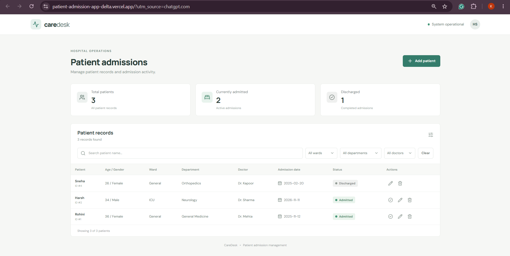
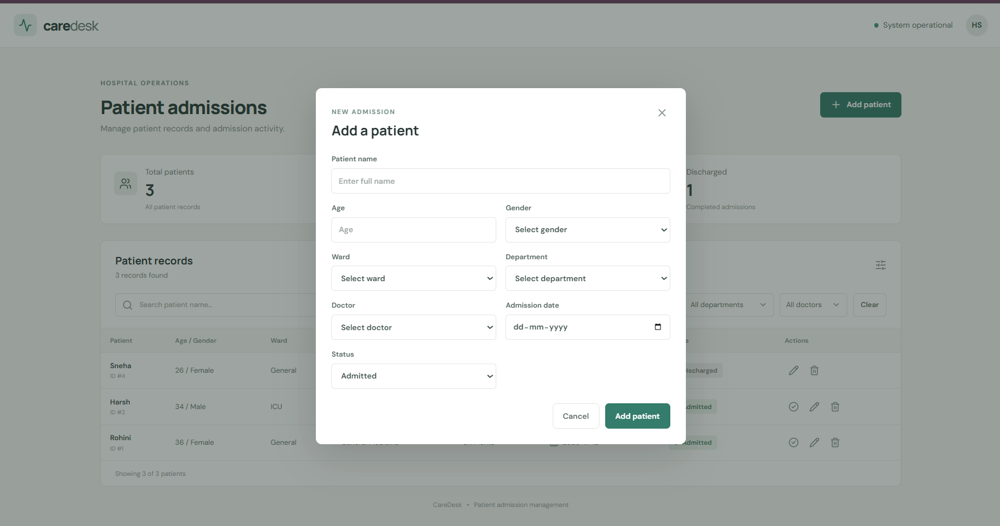
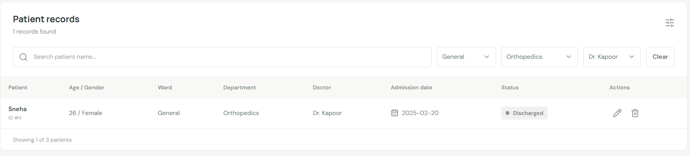
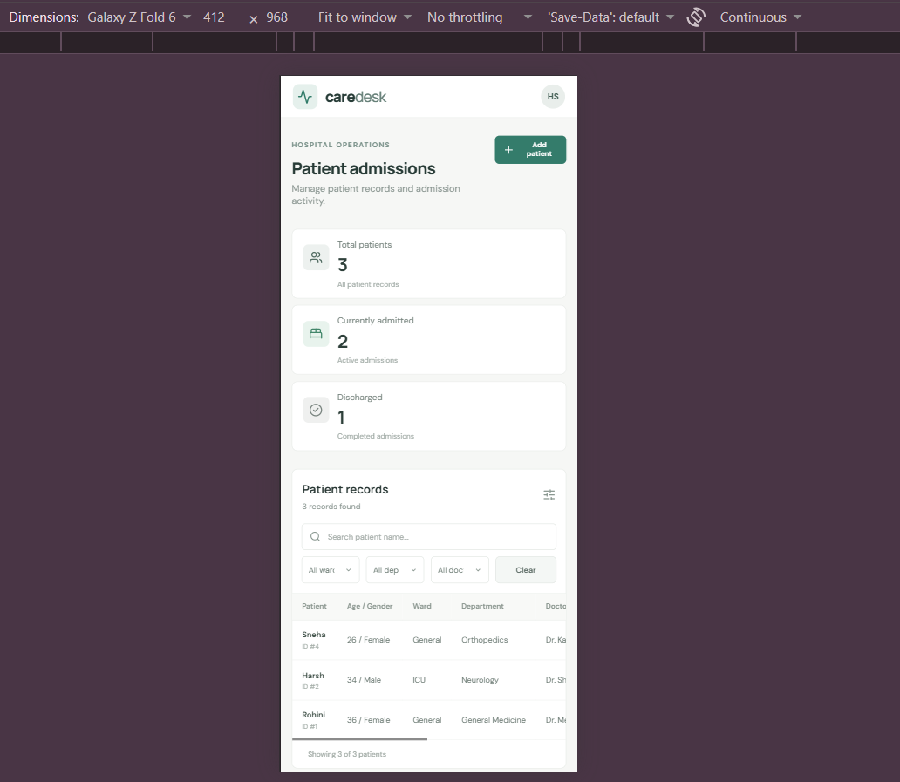

# Patient Admission Management System

A full-stack Patient Admission Management application built with React, Go, and PostgreSQL, featuring patient registration, record management, search, filtering, and admission status tracking.

## Live Application

**Frontend:** https://patient-admission-app-delta.vercel.app/

**Backend API:** https://patient-admission-app-2yma.onrender.com

**GitHub Repository:** https://github.com/Kashish-Malhotra/patient-admission-app

## Tech Stack

| Layer | Technology |
|---|---|
| Frontend | React.js, Vite |
| Backend | Go (Golang) |
| Database | PostgreSQL |
| Database Hosting | Neon |
| Frontend Hosting | Vercel |
| Backend Hosting | Render |

## Features

- Add new patient admission records.
- View all registered patients.
- Edit existing patient details.
- Delete patient records with confirmation.
- Mark patients as discharged.
- Search patients by name.
- Filter patients by ward, department, and doctor.
- Validate patient information on both frontend and backend.
- Persistent data storage using PostgreSQL.
- Responsive interface for desktop, tablet, and mobile devices.

## Patient Information

Each patient record includes:

- Name
- Age
- Gender
- Ward
- Department
- Doctor
- Admission Date
- Admission Status (Admitted / Discharged)

## Validation

The application implements validation at both frontend and backend levels.

- Name is required and accepts letters only.
- Age must be between 0 and 120.
- Gender, ward, department, and doctor must be valid selections.
- Admission date is required and cannot be a future date.
- The backend independently validates incoming requests and returns clear error messages for invalid data.

## Project Structure

```text
patient-admission-app/
│
├── backend/
│   ├── database/
│   ├── handlers/
│   ├── models/
│   ├── routes/
│   ├── main.go
│   ├── go.mod
│   └── .env
│
├── frontend/
│   ├── src/
│   │   ├── components/
│   │   ├── services/
│   │   ├── App.jsx
│   │   └── ...
│   ├── package.json
│   └── ...
│
└── .gitignore
```

## Running Locally

### Prerequisites

- Go
- Node.js and npm
- PostgreSQL database

### 1. Clone the repository

```bash
git clone https://github.com/Kashish-Malhotra/patient-admission-app.git
cd patient-admission-app
```

### 2. Configure the backend

Navigate to the backend directory:

```bash
cd backend
```

Create a `.env` file and add your PostgreSQL connection string:

```env
DATABASE_URL=your_postgresql_connection_string
```

Install dependencies and start the Go server:

```bash
go mod tidy
go run .
```

The backend runs on port `8082` by default.

### 3. Configure the frontend

Open another terminal:

```bash
cd frontend
npm install
npm run dev
```

The Vite development server will provide the local frontend URL.

For local development, the frontend uses:

```text
http://localhost:8082/api
```

## API Endpoints

| Method | Endpoint | Description |
|---|---|---|
| GET | `/health` | Health check |
| GET | `/api/patients` | Retrieve patients |
| POST | `/api/patients` | Add a patient |
| PUT | `/api/patients/:id` | Update a patient |
| DELETE | `/api/patients/:id` | Delete a patient |
| PATCH | `/api/patients/:id/discharge` | Mark patient as discharged |

## Screenshots

### Dashboard


### Add Patient


### Search and Filters


### Responsive Mobile View


## Deployment

- Frontend hosted on Vercel.
- Go backend hosted on Render.
- PostgreSQL database hosted on Neon.

Environment variables and database credentials are kept outside the public repository.
